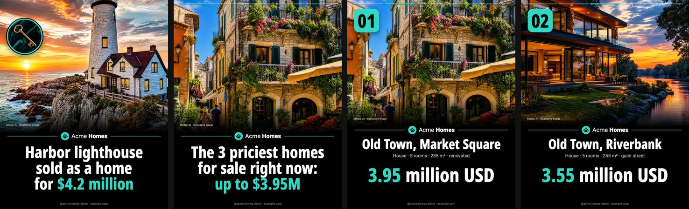

# instagram-posts: automatic Instagram posting with Claude Code + Composio

A Claude Code skill that runs an Instagram page on its own. It **researches, validates, designs
and publishes** posts in one consistent "news" look, for any niche (finance, tech, sports, food,
real estate, your product). It can work attended (you approve each post) or fully automatic from
a scheduled cloud routine. Every number is checked before it reaches a slide, because a public post
can't be edited or deleted through the API.




*The demo uses a made-up real-estate brand only as an example niche. Its places, prices and story are invented, and the pictures are AI-generated. Sources: [`examples/`](examples/).*

## What it runs on

| Piece | What it's used for |
|---|---|
| **[Claude Code](https://claude.com/claude-code)** | The runtime. The agent reads `SKILL.md` and does the research (web search and fetch), the writing, the checks and the judgment calls, then runs the scripts. |
| **Claude Code scheduled routines** (cloud) | Autopilot mode: a routine wakes every few hours in a cloud sandbox, runs `scripts/setup.sh`, and posts once. |
| **[Composio](https://composio.dev)** | The Instagram connection: OAuth login and the Instagram Graph API proxy. Locally through the Composio **CLI** (`composio link instagram`); in a cloud routine through the Composio **MCP connector** (its remote workbench runs the API calls). No Meta developer app needed. |
| **[kie.ai](https://kie.ai)** | Generates each slide's picture (GPT Image 2) and hosts the rendered JPEGs at a public URL for 24 h so Instagram can fetch them. |
| **Playwright + Chromium** | Renders the HTML slides to 1080×1350 PNG/JPEG. |
| **Python 3 + Pillow** | Every pipeline script (stdlib plus Pillow, no other dependencies). |
| **Claude Artifacts** (optional) | PREVIEW runs publish a private page with the post instead of posting it. |

## What it does

| Step | What happens | Script |
|---|---|---|
| **Research** | Scores the week's stories in your niche (Google News + RSS feeds from `brand.json`), optionally pulls top-N lists and stats from your own data, and reads the articles | `radar.py`, `datasource.py` |
| **Validate** | Requires two independent outlets or a primary source, checks every item against the source of truth, and runs a checklist for duplicates, placeholders, outliers and stale news | `reference/validation.md`, `datasource.py check` |
| **Design** | Generates a picture per slide (no text in the image), typesets every word in HTML, then renders 1080×1350 PNG/JPEG | `art.py`, `slides.py`, `render.cjs` |
| **Gate** | Every caption number must be on a slide or in `facts`. Sources must be filled, banned words, em dashes and repeats of recent posts are blocked, and missing fonts or clipped text fail the render | `check.py`, `render.cjs` |
| **Publish** | Hosts the JPEGs, creates the containers, publishes, reads the post back and logs it to a ledger | `publish.py` (local) / `ig_workbench.py` (cloud) |

The look (photo, round insets, wordmark on a divider, black band with a condensed headline and
accent words, credit line) comes from [`brand.json`](brand.json): name, handle, colours, fonts,
logo, copy strings, banned words, posting limits and radar queries. Set `"lang": "he"` (or another
RTL language) and the layout mirrors.

## Two ways to run

- **Attended.** You chat with Claude Code: *"Make today's 3 Instagram posts."* It researches,
  builds a review sheet (`review.html`) and waits. You approve specific posts, and only those get
  published.
- **Autopilot.** A scheduled cloud routine publishes one post per run, with no human review. The
  automated gates are the only review, so the rules are strict: a daily cap, minimum spacing, quiet
  hours, and "when in doubt, post nothing". See [`reference/autopilot.md`](reference/autopilot.md).

Both modes support a **dry run**: everything is built, including the Instagram containers, and
nothing is published.

## Install

Paste this into Claude Code:

> Install the skill from https://github.com/Adialia1/instagram-posts-skill and set it up

The agent follows [INSTALL.md](INSTALL.md). To do it by hand, follow the same file.

**You need:** Python 3.10+, Node 18+, a [kie.ai](https://kie.ai) API key (art + temporary image
hosting, about $0.05 per picture), a [Composio](https://composio.dev) account, and an Instagram
**professional** account (Business or Creator).

## Honest limits

- **The Instagram API can't add music.** Music on a photo or carousel exists only in the phone app.
- **The Instagram API can't edit a caption or delete a post.** That is why approval (or the
  autopilot's gates) comes first.
- **Bursts get blocked.** Around 20 posts in 40 minutes earned "action is blocked" (code 4 / subcode
  2207051), and that "blocked" post went live anyway. `publish.py` caps posts per day, waits between
  posts, and checks whether a post went live before reporting a failure. Never retry into a block.
- **Validation rejects a lot.** Expect about 40 % of candidates to fail (old articles that look new,
  single-source exclusives, advertorials, data errors). Fewer posts is the correct outcome.
- **AI pictures are illustrations.** They never show a real person or pretend to be a specific real
  property, and the slide's credit line says so. Real people get a free-licensed Wikimedia photo or
  no face at all.
- Your own data is optional. The shipped data source is **mock** (invented items). Connecting yours
  (a database, a CSV, an API) takes a small Python module ([`reference/data-sources.md`](reference/data-sources.md)).

## Layout

```
SKILL.md              the agent's instructions (Claude Code loads this)
brand.json            your brand: identity, colours, fonts, copy rules, limits, radar
INSTALL.md            setup steps an agent can follow end to end
reference/            content plan, validation checklist, posts.json schema, data sources, autopilot
scripts/              the pipeline (Python stdlib + Pillow, one Node renderer)
scripts/sources/      data-source modules (mock.py ships; add yours)
data/                 mock items for the demo (invented)
assets/               logo + OFL fonts (Noto Sans Hebrew, Heebo) with their licences
examples/             demo posts: posts.json, art, rendered jpg/
```

## License

Code: MIT ([LICENSE](LICENSE)). Fonts: SIL Open Font License 1.1 (`assets/fonts/OFL-*.txt`).
Example pictures: AI-generated for this repo.
